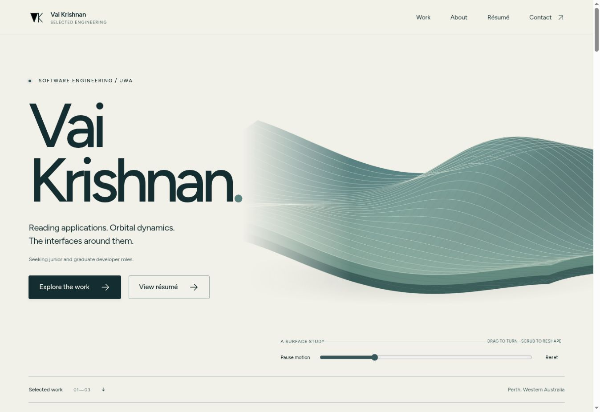
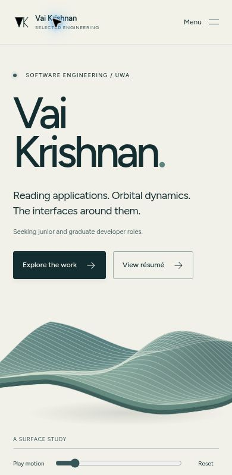

# Vai Krishnan — Selected engineering

My software engineering portfolio: **Hush**, **Gateway** and **Search Atlas**, with case studies, experience and a downloadable CV.

**[Visit the portfolio](https://krishnuni.github.io/portfolio/)** · [Design](docs/DESIGN.md) · [Architecture](docs/ARCHITECTURE.md) · [Verification](docs/VERIFICATION.md)



## The experience

The interface uses mineral teal, mist and pearl. An original analytic surface gives the opening a physical presence: drag to turn it, scrub its phase or pause it. This is a design study, not a gravitational simulation. WebGL is loaded separately; an interactive Canvas projection and a static SVG provide simpler alternatives.

The projects have different compositions within the same visual system. Hush has a product/architecture cutaway. Gateway gets a dark scientific viewport. Search Atlas has a small, independently written weighted pathfinding study with A*, Dijkstra, BFS, editing and replay. The complete applications open through explicit links; their heavy runtimes and models are not embedded in the portfolio.

Permanent case-study pages cover purpose, implementation scope, three decisions, architecture, evidence and limits. The CV is the supplied October 2026 document, served unchanged as a PDF. About and experience are grounded in that document and the project repositories.

<details>
<summary>Phone composition</summary>



</details>

## Run locally

Use Node.js 24 and the committed lockfile:

```sh
npm ci
npm run dev
```

For a production build:

```sh
npm test
npm run build
npm run preview
```

The build is static. No API key, account, database or application server is needed at runtime.

## Verify

```sh
npm run typecheck
npm test
BASE_PATH=/portfolio/ npm run build
npx playwright install --with-deps chromium
BASE_PATH=/portfolio/ npm run test:browser
```

In PowerShell, set `$env:BASE_PATH = '/portfolio/'` for the project-path build and browser checks. Browser tests use the actual built artifact, including its base path. They cover desktop/phone navigation, CV delivery, case studies, architecture reveal, keyboard controls, weighted search, the reading study, overflow, reduced motion and selected automated accessibility checks. [Executed results and limits](docs/VERIFICATION.md) are separate from configured tests.

## Repository map

| Location                      | Responsibility                                                      |
| ----------------------------- | ------------------------------------------------------------------- |
| `src/content/projects.json`   | Curated project descriptions, source links, evidence and limits     |
| `scripts/generate-pages.mjs`  | Complete static HTML for the homepage, case studies, résumé and 404 |
| `src/main.ts`                 | Navigation, cutaway, reading study and search playback              |
| `src/lib/search.ts`           | Original small search implementation for this portfolio             |
| `src/surface.ts`              | Deferred Three.js renderer                                          |
| `src/surface-fallback.ts`     | Interactive Canvas renderer when WebGL is unavailable               |
| `src/lib/surface-math.ts`     | Shared analytic design geometry                                     |
| `src/style.css`               | Responsive layout, material, typography and motion system           |
| `public/`                     | Local fonts, actual project images, original SVG and CV             |
| `tests/`                      | Independent algorithm comparisons and production browser flows      |
| `.github/workflows/pages.yml` | Verification, static build and Pages deployment                     |

Portfolio-specific source was newly implemented. Existing application repositories supply screenshots and documentation; their application code is not copied or modified.

## Deploy and maintain

GitHub Pages uses the **GitHub Actions** publishing source. Pushes to `main` run the checks, build for the configured Pages base path and deploy only after verification succeeds. Pull requests verify without deployment. No long-lived deployment credential is stored in source.

The preferred address is `vai.is-a.dev`. Its maintainers require the registrant to submit their own request. [Domain setup](docs/DOMAIN.md) explains the records and the switch after approval. Until then, the Pages address is canonical.

Edit the manifest and build script, then run the checks. Generated HTML, dependencies and build output are ignored. The source and lockfile reproduce the site.

## Credits and rights

Portfolio-specific source, writing and original design assets: copyright Vai Krishnan. No open-source grant has been selected for that code. Three.js retains its MIT licence; Figtree retains the SIL Open Font License. Their notices are in the deployed [colophon](public/third-party-notices.txt). Project captures and the CV retain their respective authorship.
